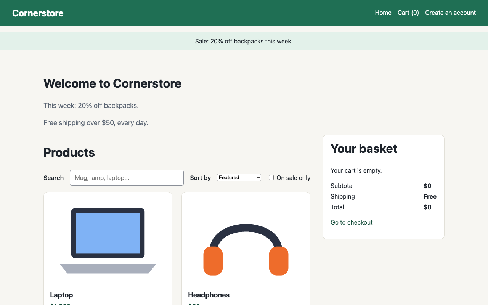

# Cornerstore

An online store built step by step, from plain HTML to a full application.

## What works today

- Browse products
- Search and filter
- A cart that survives a refresh
- A checkout form with validation

## How to run it

```
cd apps/web
python3 -m http.server
```

Then open http://localhost:8000.

## Built with

HTML, CSS and JavaScript, with no framework yet.

## How I used AI

Parts of this project were written with AI tools. I review and test every change.


